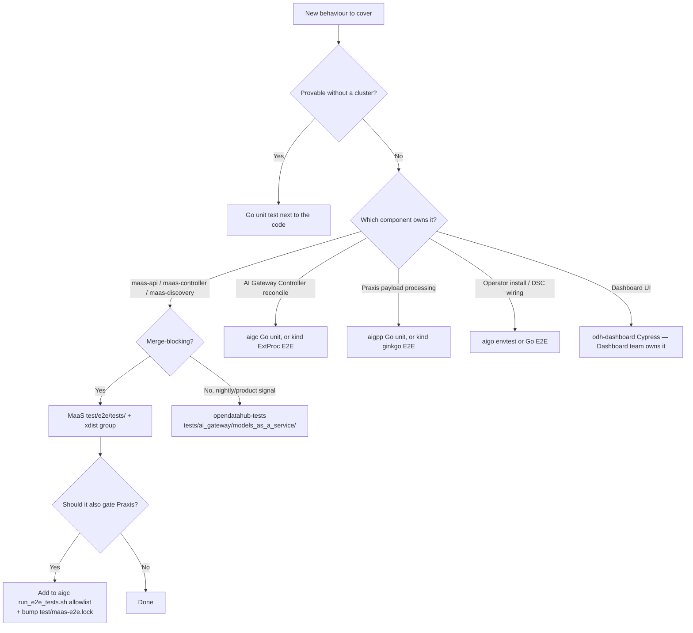

# Where to add a test

The question this page answers: *I have a behaviour to cover. Which repo, which suite,
which file?*

## Decision tree



## Rules

**Default to a Go unit test.** Cluster time is the bottleneck. A reconcile branch, a
header parse, a subscription match, a TLS profile choice — all unit-testable. Only reach
for E2E when the behaviour genuinely depends on a live gateway, Authorino, Limitador, or
a real inference backend.

**MaaS `test/e2e` vs `opendatahub-tests`:**

| Put it in MaaS `test/e2e` when | Put it in `opendatahub-tests` when |
|--------------------------------|------------------------------------|
| It must block a bad merge | It validates the shipped product build |
| It exercises MaaS CRs and the gateway directly | It spans RHOAI components or the operator lifecycle |
| It can run on an ephemeral Hypershift cluster in under ~90 min total | It needs a long-lived cluster, upgrade, or disconnected env |
| Other repos (aigc) should inherit it | It is upgrade, observability, or disconnected-specific |

**Never write the same scenario in both.** Pick one home. If a nightly keeps catching
something a PR gate should have caught, move the test up, don't copy it.

## Adding a MaaS E2E test

1. Create or extend a module in `test/e2e/tests/`.
2. Tag it with an **xdist group** so it lands on the right worker:

   ```python
   @pytest.mark.xdist_group("api_keys")
   ```

   Existing groups: `readonly`, `api_keys`, `models`, `security`, `mt_lifecycle`,
   `tenant_isolation`, `tenant_ipp`, `tenant_inference`, `tenant_auto_resolve`,
   `external`, `serial`.

   - `readonly` — must not mutate cluster state.
   - `serial` — destructive (restarts a controller, deletes a CRD). Runs in the second pass.
   - Tenant groups — anything that creates or mutates AITenants.

3. Reuse fixtures from `conftest.py` and helpers from `test_helper.py` /
   `multitenancy_helpers.py`. Do not hand-roll a new auth flow.
4. Assert on the **response body**, not just the status code. `assert_inference_response()`
   exists because a 200 with an empty body shipped once already.
5. Verify collection passes on Python 3.11 — the `e2e-collect.yml` gate runs
   `pytest --collect-only` without a cluster and will fail on an import error.
6. Run it locally against a cluster before opening the PR:

   ```bash
   ./test/e2e/run-tests-quick.sh
   ```

### If it should also gate Praxis

Landing it in MaaS is not enough. In `ai-gateway-controller`:

1. Add the module to the allowlist array in `test/e2e/scripts/run_e2e_tests.sh`.
2. Bump the pin: `MAAS_UPDATE_LOCK=true bash test/e2e/scripts/fetch-maas-e2e.sh`.
3. If the module cannot run there yet, add a row to `test/e2e/TODO.md` with the
   **requirement to re-introduce** — not just "excluded".

## Adding an opendatahub-tests test

1. Pick the right package under `tests/ai_gateway/models_as_a_service/`
   (`maas_api_key/`, `maas_subscription/`, `multitenancy/`, `oidc_tests/`,
   `external_model/`, `observability/`, `praxis/`, `upgrade/`, `component_health/`,
   `body_base_routing/`).
2. Follow the repo's class-based convention and `structlog` logging. This suite is
   **not** structured like MaaS `test/e2e` — do not copy that style over.
3. Add a tier marker: `smoke`, `tier1`, `tier2`, or `tier3`. Upgrade tests need
   `pre_upgrade` / `post_upgrade`.
4. Check it collects: `uv run pytest --collect-only <path>`.

## Review checklist

Before asking for review on a test PR:

- [ ] Is a unit test enough? If yes, it isn't an E2E test.
- [ ] Does an equivalent already exist in another suite? (Search both repos.)
- [ ] Correct xdist group / tier marker.
- [ ] No new hand-rolled auth, deploy, or polling helper that duplicates an existing one.
- [ ] Asserts on content, not just status codes.
- [ ] Deterministic: no `sleep`-based synchronization, no dependence on test ordering.
- [ ] Cleans up what it creates, or uses a fixture that does.
- [ ] If it's destructive, it's in a serial group.
- [ ] If it should gate Praxis, the aigc allowlist and lock are updated in the same change.
- [ ] Inventory updated if a whole new module or area was added.

## Common mistakes

| Mistake | Why it hurts |
|---------|--------------|
| Adding to `opendatahub-tests` because it's easier | Doesn't block the bad merge; the regression ships anyway |
| Mutating cluster state from a `readonly`-group module | Corrupts every other test on that worker |
| Copying a MaaS E2E test into the nightlies | Two places to fix, two places to flake |
| Landing a MaaS E2E test without touching the aigc allowlist | Looks covered, never runs on the Praxis gate |
| Using the old `tests/model_serving/maas_billing/` path | Suite moved to `tests/ai_gateway/models_as_a_service/` |
| `time.sleep()` to wait for reconcile | Primary source of CI flakes; poll on condition instead |
