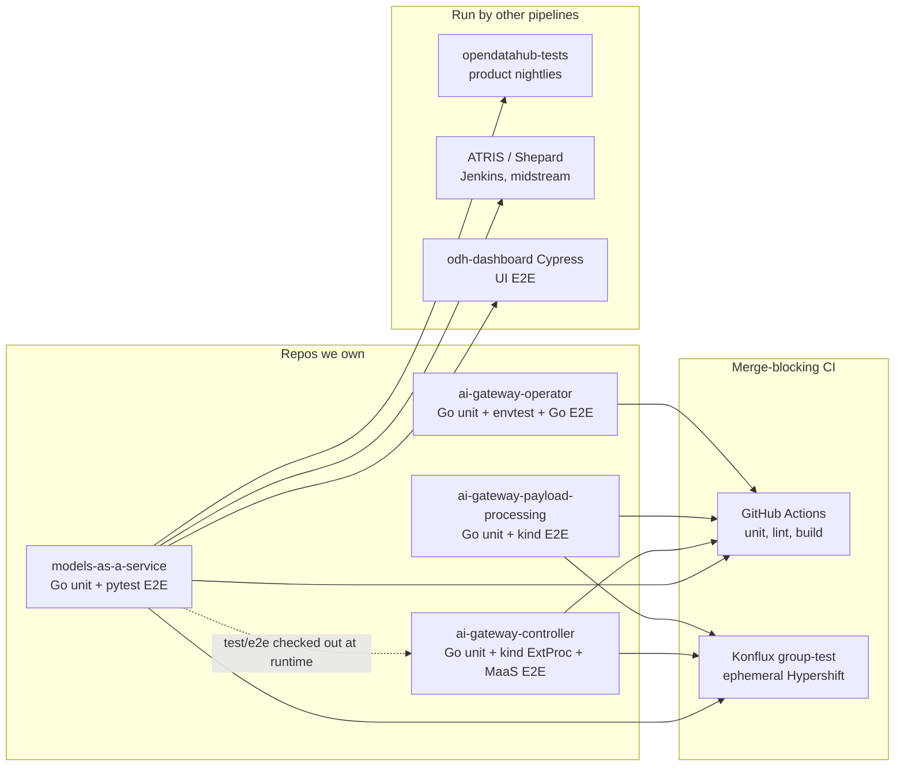

# MaaS Test Knowledge Base

Single entry point for every test that covers Models-as-a-Service and the AI Gateway
components. If you are contributing a test, start here and follow the decision tree in
[Where to add a test](contributing-tests.md).

!!! info "Scope"
    This knowledge base covers the four repositories the MaaS team owns or co-owns
    (`models-as-a-service`, `ai-gateway-controller`, `ai-gateway-payload-processing`,
    `ai-gateway-operator`) plus the suites other teams run against our components
    (`opendatahub-tests` nightlies, ATRIS/Shepard, odh-dashboard Cypress).

## Pages

| Page | What it answers |
|------|-----------------|
| [Test inventory](test-inventory.md) | What tests exist, where they live, what they cover, who owns them |
| [Pipelines and execution](ci-pipelines.md) | How each suite runs, what triggers it, what gates a merge |
| [Where to add a test](contributing-tests.md) | Decision tree + checklist for a new test |
| [Performance testing](performance-testing.md) | Current state of load/scale testing and the open gaps |

## The 60-second map

## Suites at a glance

| Suite | Repo | Language | Count | Blocks merge | Owner |
|-------|------|----------|-------|--------------|-------|
| `maas-api` unit | models-as-a-service | Go | 369 funcs | Yes (GH Actions) | MaaS |
| `maas-controller` unit | models-as-a-service | Go | 658 funcs | Yes (GH Actions) | MaaS |
| `maas-discovery` unit | models-as-a-service | Go | 106 funcs | Yes (GH Actions) | MaaS |
| PostgreSQL integration | models-as-a-service | Go (build tag) | opt-in | No | MaaS |
| MaaS E2E (pytest) | models-as-a-service | Python | 34 test modules / ~309 tests | Yes (Konflux group-test) | MaaS |
| Operator chaos | models-as-a-service | GH Action | 1 workflow | Yes (path-filtered) | MaaS |
| AIGC unit + envtest | ai-gateway-controller | Go | 32 files | Yes | AIGC |
| AIGC kind ExtProc E2E | ai-gateway-controller | Bash + kind | 5 scripts | Not yet ([RHOAIENG-97471](https://issues.redhat.com/browse/RHOAIENG-97471)) | AIGC |
| AIGC Praxis E2E (runtime checkout of MaaS E2E) | ai-gateway-controller | Python (fetched) | allowlist subset | Yes | AIGC + MaaS |
| AIGPP unit | ai-gateway-payload-processing | Go | 38 files | Yes | Praxis |
| AIGPP kind E2E | ai-gateway-payload-processing | Go (ginkgo) | 1 suite | Yes | Praxis |
| AIGO unit + envtest | ai-gateway-operator | Go | 13 files | Yes | AIGO |
| AIGO E2E | ai-gateway-operator | Go | 4 files | Manual / cluster | AIGO |
| MaaS nightlies | opendatahub-tests | Python | ~70 modules / 11 areas | No (nightly signal) | MaaS + QE |
| ATRIS / Shepard | atris pipelines | Python (reuses midstream `test/e2e`) | varies | No | ATRIS org |
| Dashboard UI E2E | odh-dashboard | Cypress | `modelsAsAService` specs | Dashboard CI | Dashboard team |
| Performance / scale | — (PSAP CPT pipeline) | — | external | No | see [Performance testing](performance-testing.md) |

Counts are a snapshot taken when this page was written; treat them as orders of
magnitude, not contract. The authoritative number is whatever `go test ./...` and
`pytest --collect-only` report today.

## Keeping this current

This knowledge base is only as good as its last verification. The rule: **any PR that
adds, moves, or removes a test, suite, or pipeline updates the relevant page here in the
same PR.** Reviewers: treat an unchanged KB on a test-touching PR as a review blocker,
the same way you would an unchanged OWNERS file. Counts are snapshots (see the "as of"
notes); when you touch a page, re-run the count commands in its header comment if any.

## Rules of thumb

1. **Unit test first.** If the behaviour can be proven without a cluster, it belongs in
   a Go unit test next to the code. E2E time is the scarcest resource we have.
2. **One home per behaviour.** A scenario lives in exactly one suite. Duplicating a MaaS
   E2E case into `opendatahub-tests` doubles the maintenance and the flake surface.
3. **MaaS `test/e2e` is a shared asset.** `ai-gateway-controller` checks it out at
   runtime against a pinned SHA. Breaking it breaks another repo's CI.
4. **Nightlies are not a merge gate.** Anything that must block a bad merge has to run
   in GitHub Actions or the Konflux group-test pipeline.
